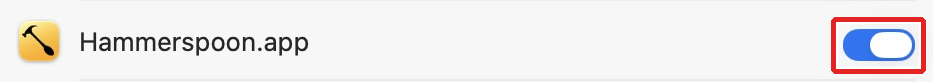
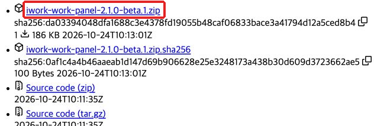
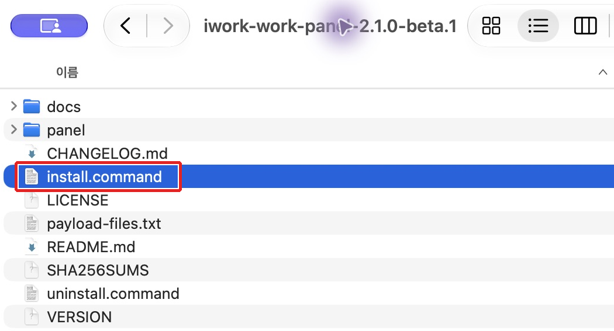
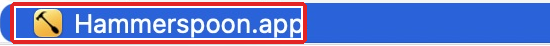
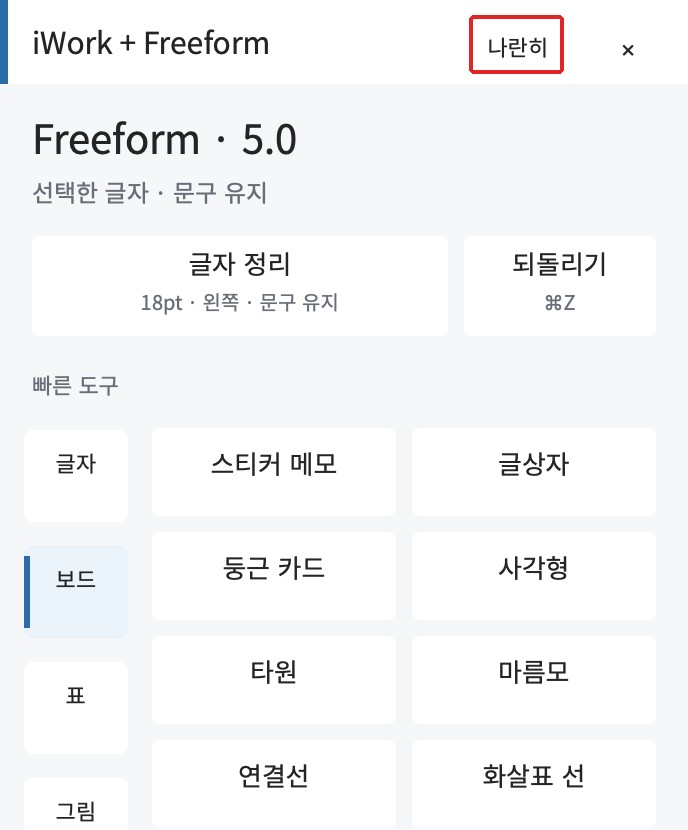
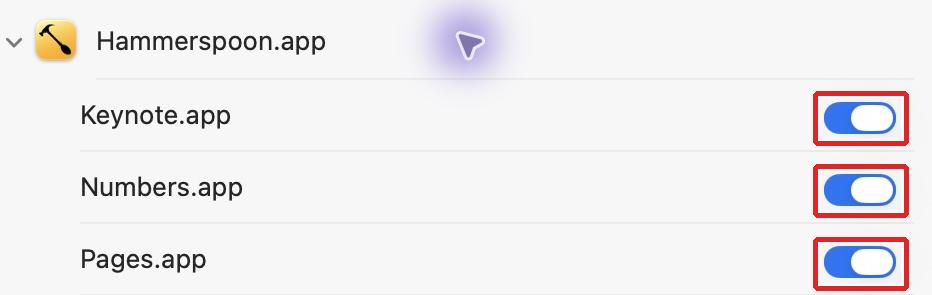
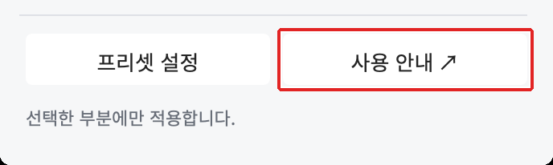

# iWork + Freeform · WORK 편집 패널

Pages·Numbers·Keynote·Freeform의 자주 쓰는 편집 기능을 옆에 띄워 두고 클릭하는 Mac용 Hammerspoon 설정입니다. 앱에 맞춰 도구가 바뀌며 글자·셀·표·사진·차트·보드를 편집합니다.

**2.1.0-beta.2 · Mac 설치형 베타 · 한국어 메뉴 기준**

[설치 ZIP 다운로드](https://github.com/Kimmahone/iwork-work-panel/releases/tag/v2.1.0-beta.2) · [kimmahone.com 소개](https://kimmahone.com/projects/#progress-iwork-work) · [사용 안내](panel/사용%20안내.html) · [검증 범위](docs/VERIFICATION.md)


## 설치하기

**ZIP을 내려받았다면 압축을 푼 폴더의 `설치 안내.html`을 먼저 더블클릭하세요.** 캡처 9장을 함께 담아 인터넷 없이도 설치 순서를 읽을 수 있습니다. `docs` 폴더와 안내 파일을 함께 두세요. 앱을 새로 다운로드할 때는 인터넷이 필요합니다.

[동봉 오프라인 설치 안내](설치%20안내.html)

Mac에서 아래 1~8번을 차례로 진행하세요. Hammerspoon은 패널을 실행하는 앱이고, WORK 패널은 그 안에 설치하는 편집 도구입니다. 사용할 Pages·Numbers·Keynote 또는 Freeform 앱도 준비해 주세요. 이미 끝낸 단계는 건너뛰면 됩니다. 단계마다 실제 화면 캡처를 붙였습니다. 빨간 박스는 누르거나 상태를 확인할 위치입니다. 권한 스위치는 꺼져 있을 때만 눌러 켜고, 이미 파란색이면 그대로 두세요. 이미지를 누르면 크게 볼 수 있습니다. 캡처는 macOS 27.0.1 기준이며, 버전에 따라 메뉴 이름과 화면 모양이 다를 수 있습니다.

[사이트에서 같은 설치 안내 보기](https://kimmahone.com/projects/#progress-iwork-work-install)

Hammerspoon과 이 패널은 무료로 사용할 수 있습니다. 유료 Apple 개발자 계정은 필요하지 않습니다. Pages·Numbers·Keynote·Freeform은 별도로 설치되어 있어야 하며, 패널은 앱의 기본 편집 기능을 호출합니다.

### 1. Hammerspoon 설치하기

아래 공식 사이트에서 Download latest release를 눌러 ZIP을 받습니다. 압축을 풀고 Hammerspoon.app을 응용 프로그램(Applications) 폴더로 옮긴 뒤 실행합니다.

[Hammerspoon 공식 다운로드](https://www.hammerspoon.org/)

<a href="docs/install/01-hammerspoon-download.png"></a>

빨간 박스의 Download the latest release를 누른 뒤 앱을 응용 프로그램 폴더로 옮깁니다.

**확인:** 화면 위 메뉴 막대에 Hammerspoon 아이콘이 보입니다.

### 2. 손쉬운 사용 권한 켜기

Apple 메뉴 → 시스템 설정 → 개인정보 보호 및 보안에서 손쉬운 사용을 엽니다. macOS 27처럼 “기기 제어 및 데이터 접근”으로 표시되는 경우에는 그 항목을 엽니다. Hammerspoon을 켜고, 목록에 없으면 +로 응용 프로그램 폴더의 Hammerspoon.app을 추가합니다. Mac 암호나 Touch ID 확인은 본인이 시스템 설정에서 진행합니다.

<a href="docs/install/02-access-title.png"></a>

이 Mac에서는 손쉬운 사용에 해당하는 권한이 기기 제어 및 데이터 접근으로 표시됩니다.

<a href="docs/install/02-access-toggle.png"></a>

빨간 박스의 스위치가 꺼져 있을 때만 눌러 켭니다. 캡처처럼 파란색이면 이미 허용된 상태이므로 다시 누르지 마세요.

**확인:** Hammerspoon의 스위치가 파란색으로 켜져 있습니다. 이 권한으로 패널이 키 입력과 편집 메뉴를 제어합니다.

### 3. WORK 패널 설치 ZIP 받기

아래 릴리스 페이지의 Assets에서 iwork-work-panel-2.1.0-beta.2.zip을 내려받고 압축을 풉니다. Source code ZIP 대신 이름이 정확히 같은 설치용 ZIP을 고르세요. Hammerspoon 설치 ZIP과는 별도 파일입니다.

[WORK 패널 설치 ZIP 받기](https://github.com/Kimmahone/iwork-work-panel/releases/tag/v2.1.0-beta.2)

<a href="docs/install/03-assets.png"></a>

빨간 박스로 표시한 설치 ZIP을 누릅니다. 캡처는 beta.1 예시이며, 현재 파일명은 `iwork-work-panel-2.1.0-beta.2.zip`입니다. 아래의 Source code는 설치용 ZIP이 아닙니다.

**확인:** 압축을 푼 폴더 안에 install.command, panel 폴더, SHA256SUMS가 함께 있습니다.

### 4. install.command 실행하기

압축을 푼 폴더의 install.command를 더블클릭합니다. 터미널 창에서 설치가 끝날 때까지 기다립니다. 스크립트만 따로 옮기지 말고 panel 폴더 등과 함께 둔 상태에서 실행하세요. 기존 Hammerspoon 설정은 자동으로 백업합니다.

<a href="docs/install/04-install-folder.png"></a>

같은 폴더에 panel과 SHA256SUMS가 있는지 확인한 뒤 빨간 박스의 install.command를 더블클릭합니다. 캡처의 beta.1 폴더명은 이전 예시이며, 이번 폴더명은 2.1.0-beta.2입니다.

**확인:** 터미널에 “설치 완료”와 “기존 설정 백업” 경로가 표시됩니다. 이 단계에서 명령어를 직접 입력할 필요는 없습니다.

### 5. Hammerspoon 설정 불러오기

메뉴 막대의 Hammerspoon 아이콘을 누르고 Reload Config를 선택합니다. WORK 패널 설정을 처음 불러오거나 업데이트했을 때 하는 단계입니다. 아이콘이 보이지 않으면 응용 프로그램의 Hammerspoon.app을 다시 엽니다. 콘솔 창의 File → Reload Config에서도 실행할 수 있습니다.

<a href="docs/install/05-hammerspoon-app.png"></a>

앱이 실행되지 않았다면 빨간 박스의 Hammerspoon.app을 더블클릭합니다. 이 캡처는 앱 위치이며, Reload Config는 화면 위 메뉴 막대의 Hammerspoon 메뉴에서 누릅니다.

**확인:** 메뉴 막대에 ✦ 편집 메뉴가 나타납니다.

### 6. 문서나 보드에서 패널 열기

사용할 앱에서 새 문서 또는 보드를 엽니다. 메뉴 막대의 ✦ 편집 → 클릭 패널 보이기 / 숨기기를 누릅니다. 필요하면 패널 위의 나란히로 문서와 패널을 옆에 배치합니다.

<a href="docs/install/06-panel.png"></a>

현재 앱 이름이 표시되는지 확인합니다. 빨간 박스의 나란히를 누르면 문서와 패널을 옆에 배치할 수 있습니다. Freeform 예시입니다.

**확인:** 패널 상단에 현재 사용하는 Pages·Numbers·Keynote·Freeform 이름이 표시됩니다.

### 7. 처음 편집할 때 앱 제어 허용하기

시험용 글자나 셀을 선택하고 패널의 글자·셀 프리셋을 누릅니다. “Hammerspoon이 Pages·Numbers·Keynote를 제어하려고 합니다”라는 macOS 창이 나타나면 사용할 앱에 대해 허용을 직접 누른 뒤 같은 버튼을 다시 실행합니다. 나중에는 시스템 설정 → 개인정보 보호 및 보안 → 자동화 → Hammerspoon에서 요청된 앱을 확인할 수 있습니다.

<a href="docs/install/07-automation.png"></a>

Hammerspoon을 펼쳐 빨간 박스의 앱별 스위치를 확인합니다. 사용할 앱이 꺼져 있을 때만 눌러 켭니다. 캡처처럼 파란색이면 그대로 두세요. 최초 제어 요청 전에는 항목이 없을 수 있습니다.

**확인:** 사용할 앱의 제어 요청이 허용되어 있습니다. 앱을 처음 제어할 때 요청하므로 목록이 미리 없을 수 있습니다. Freeform은 손쉬운 사용을 이용하며 별도 자동화 창이 뜨지 않을 수 있습니다.

### 8. 첫 편집과 사용 안내 확인하기

글자·셀·메모를 먼저 선택한 뒤 원하는 프리셋을 누릅니다. 서식이 바뀌는지 확인하고, 패널의 사용 안내를 눌러 현재 앱 설명을 읽어 보세요. Freeform에서는 메모·글상자 / 도형 연결 / 표 / 사진 바로가기 순서로 따라 할 수 있습니다.

<a href="docs/install/08-help.png"></a>

첫 편집 후 빨간 박스의 사용 안내를 누르면 현재 앱의 사용법으로 이동합니다.

**확인:** 선택한 대상에 서식이 적용되고 현재 앱의 사용 안내가 열리면 준비가 끝났습니다. 시험 서식은 ⌘Z로 되돌릴 수 있습니다.

### 설치를 마쳤다면

문서에서 대상 선택 → 패널 분류 선택 → 버튼 클릭. 앱을 바꾸면 패널 도구도 전환됩니다. 다음에 사용할 때는 Hammerspoon을 실행하고 ✦ 편집에서 패널을 열면 됩니다.

### 중간에 막혔나요?

<details>
<summary>install.command가 열리지 않거나 설치가 실패해요</summary>

설치용 ZIP을 받았는지, 압축을 완전히 풀었는지, install.command와 panel 폴더·SHA256SUMS가 같은 폴더에 있는지 확인하세요. macOS가 실행을 차단하면 표시된 안내를 읽고 출처를 확인하거나 아래 GitHub 설치 안내의 수동 설치 절차를 사용하세요. 터미널의 오류 문구가 남아 있으면 그 문구와 함께 문의해 주세요.

</details>

<details>
<summary>✦ 편집이나 패널이 보이지 않아요</summary>

응용 프로그램에서 Hammerspoon을 실행하고 메뉴 막대의 Hammerspoon → Reload Config를 누르세요. 이어 Pages·Numbers·Keynote 문서 또는 Freeform 보드를 클릭한 뒤 ✦ 편집 → 클릭 패널 보이기 / 숨기기를 선택합니다. Reload Config에서 오류가 뜨면 Hammerspoon Console의 오류 문구를 확인하세요.

</details>

<details>
<summary>권한 허용창이 안 뜨거나 버튼이 적용되지 않아요</summary>

글자·셀·대상체를 먼저 선택하고 패널의 앱 이름을 확인하세요. 손쉬운 사용(또는 기기 제어 및 데이터 접근)의 Hammerspoon이 켜져 있는지 확인합니다. iWork 앱 제어를 이미 거절했다면 자동화 → Hammerspoon에서 해당 앱을 켜고 다시 실행하세요. 자동화 목록이 없으면 사용할 앱에서 편집 버튼을 한 번 눌러 요청을 발생시킵니다. Freeform은 별도 자동화 창이 뜨지 않을 수 있습니다.

</details>

macOS가 설치 파일 실행을 차단하면 시스템의 안내를 확인하세요. 설치 스크립트 내용을 먼저 읽고 아래의 수동 설치를 선택할 수도 있습니다. 시스템 보안을 끄거나 권한 데이터베이스를 바꿀 필요는 없습니다.

## 사용하기

**대상 선택 → 패널 분류 선택 → 버튼 클릭** 순서입니다.

| 앱 | 주로 쓰는 도구 |
| --- | --- |
| Pages | 학습지·문서 제목, 본문 정리, 참고·붙임, 용지 여백, 보고서·비교·일정 표 |
| Numbers | 머리글·일반·강조·입력 셀, 금액·백분율, 체크리스트·예산·평가 표, 차트 |
| Keynote | 슬라이드 제목·소제목·본문·핵심 문장, 발표 표, 사진 배치, 차트 |
| Freeform | 제목·메모 서식, 도형 연결, 표 테두리, 사진 마스크, 정렬·그룹 |

패널의 **사용 안내**는 현재 앱 설명으로 이동합니다. Freeform 안내에는 **메모·글상자 / 도형 연결 / 표 / 사진** 바로가기가 있습니다. **프리셋 설정**에서 이름·크기·굵기·정렬을 바꿀 수 있습니다.

**Control + Option**과 함께 누르는 키:

| 키 | 기능 |
| --- | --- |
| 1·2·3·4 | 현재 앱의 기본 프리셋 |
| L·E·R | 왼쪽·가운데·오른쪽 정렬 |
| B | 굵게 |
| =·− | 글자 크게·작게 |
| C·V | 스타일 복사·붙이기 |
| G | 그룹 |
| K·P·H | 명령 검색·프리셋 목록·현재 앱 안내 |

## 업데이트와 제거

새 Release ZIP의 `install.command`를 실행하면 실행 파일을 갱신합니다. 사용자 프리셋과 패널 위치는 유지합니다. 백업은 `~/.hammerspoon/.iwork-work-backups`에 있습니다.

`uninstall.command`는 관리 블록을 해제하고 패널과 개인 설정을 백업 폴더로 옮깁니다. 그다음 Hammerspoon에서 **Reload Config**를 누릅니다.

## 수동 설치

1. `panel` 폴더를 `~/.hammerspoon/iwork-work`로 복사합니다.
2. `~/.hammerspoon/init.lua`의 실행 가능한 위치에 다음 한 줄을 추가합니다.

```lua
dofile(hs.configdir .. "/iwork-work/main.lua")
```

3. Hammerspoon에서 **Reload Config**를 누릅니다. 이미 이전 버전을 직접 연결했다면 그 `dofile` 줄을 새 위치로 교체하여 한 번만 불러오도록 합니다.

## 호환성

현재 실기 검증: **Pages·Numbers·Keynote Creator Studio 15.4, Freeform 5.0, 한국어 UI**. 기존 iWork 번들 ID도 인식하지만 이번 공개 ZIP은 다른 Mac·언어·모든 구버전에서 새로 검증한 결과가 아닙니다. Freeform 배경 제거·장면 등 일부 고급 기능의 결과 검증은 남아 있습니다. 자세한 항목은 [검증 범위](docs/VERIFICATION.md)를 확인하세요.

이 프로젝트는 Apple 또는 Hammerspoon의 공식 제품이 아닙니다. 개인 문서·시험 보드·기존 사용자 설정·권한은 배포본에 포함하지 않습니다. FreeformBridge나 Apple Studio Freeform 연결 앱 설치를 요구하지 않습니다.
