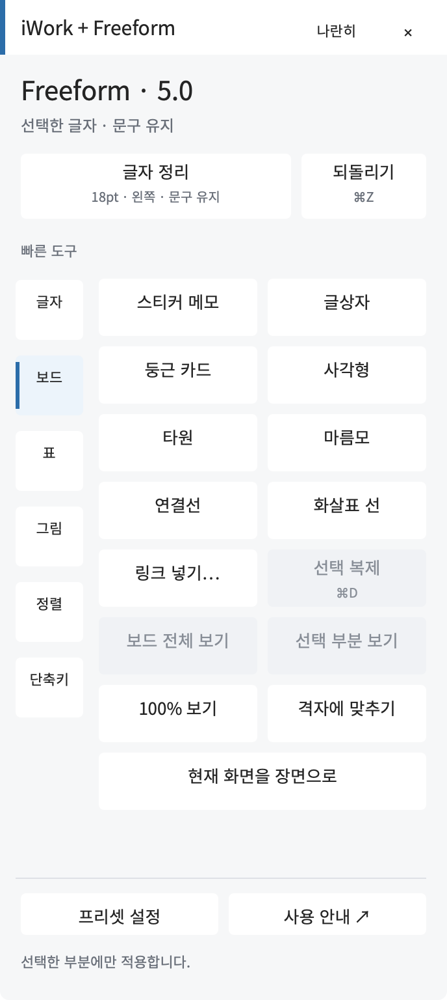

# iWork + Freeform · WORK 편집 패널

Pages·Numbers·Keynote·Freeform의 자주 쓰는 편집 기능을 옆에 띄워 두고 클릭하는 Mac용 Hammerspoon 설정입니다. 앱에 맞춰 도구가 바뀌며 글자·셀·표·사진·차트·보드를 편집합니다.

**2.1.0-beta.1 · Mac 설치형 베타 · 한국어 메뉴 기준**

[설치 ZIP 다운로드](https://github.com/Kimmahone/iwork-work-panel/releases/tag/v2.1.0-beta.1) · [kimmahone.com 소개](https://kimmahone.com/projects/#progress-iwork-work) · [사용 안내](panel/사용%20안내.html) · [검증 범위](docs/VERIFICATION.md)



## 설치하기

1. [Hammerspoon 공식 사이트](https://www.hammerspoon.org/)에서 Hammerspoon을 설치하고 한 번 실행합니다.
2. 이 저장소의 **Releases**에서 `iwork-work-panel-2.1.0-beta.1.zip`을 내려받아 압축을 풉니다. GitHub의 `Code → Download ZIP`은 개발 소스용이며 설치용 ZIP은 Releases에 있습니다.
3. 압축을 푼 폴더의 `install.command`를 실행합니다. 기존 `init.lua`와 기존 패널 파일을 백업하고, WORK 패널을 `~/.hammerspoon/iwork-work`에 설치합니다.
4. Hammerspoon 메뉴에서 **Reload Config**를 누릅니다. macOS가 요청하는 Hammerspoon의 **손쉬운 사용** 및 앱별 **자동화** 권한은 직접 허용합니다.
5. Pages·Numbers·Keynote 문서 또는 Freeform 보드를 열고 메뉴 막대의 **✦ 편집 → 클릭 패널 보이기 / 숨기기**를 누릅니다.

Hammerspoon과 이 패널은 무료로 사용할 수 있습니다. 유료 Apple 개발자 계정은 필요하지 않습니다. Pages·Numbers·Keynote·Freeform은 별도로 설치되어 있어야 하며, 패널은 앱의 기본 편집 기능을 호출합니다.

macOS가 설치 파일 실행을 차단하면 시스템의 안내를 확인하세요. 설치 스크립트 내용을 먼저 읽고 수동 설치를 선택할 수도 있습니다. 시스템 보안을 끄거나 권한 데이터베이스를 바꿀 필요는 없습니다.

## 사용하기

**대상 선택 → 패널 분류 선택 → 버튼 클릭** 순서입니다.

| 앱 | 주로 쓰는 도구 |
| --- | --- |
| Pages | 학습지·문서 제목, 본문 정리, 참고·붙임, 용지 여백, 보고서·비교·일정 표 |
| Numbers | 머리글·일반·강조·입력 셀, 금액·백분율, 체크리스트·예산·평가 표, 차트 |
| Keynote | 슬라이드 제목·소제목·본문·핵심 문장, 발표 표, 사진 배치, 차트 |
| Freeform | 제목·메모 서식, 도형 연결, 표 테두리, 사진 마스크, 정렬·그룹 |

패널의 **사용 안내**는 현재 앱 설명으로 이동합니다. Freeform 안내에는 **메모·글상자 / 도형 연결 / 표 / 사진** 바로가기가 있습니다. **프리셋 설정**에서 이름·크기·굵기·정렬을 바꿀 수 있습니다.

**Control + Option**과 함께 누르는 키:

| 키 | 기능 |
| --- | --- |
| 1·2·3·4 | 현재 앱의 기본 프리셋 |
| L·E·R | 왼쪽·가운데·오른쪽 정렬 |
| B | 굵게 |
| =·− | 글자 크게·작게 |
| C·V | 스타일 복사·붙이기 |
| G | 그룹 |
| K·P·H | 명령 검색·프리셋 목록·현재 앱 안내 |

## 업데이트와 제거

새 Release ZIP의 `install.command`를 실행하면 실행 파일을 갱신합니다. 사용자 프리셋과 패널 위치는 유지합니다. 백업은 `~/.hammerspoon/.iwork-work-backups`에 있습니다.

`uninstall.command`는 관리 블록을 해제하고 패널과 개인 설정을 백업 폴더로 옮깁니다. 그다음 Hammerspoon에서 **Reload Config**를 누릅니다.

## 수동 설치

1. `panel` 폴더를 `~/.hammerspoon/iwork-work`로 복사합니다.
2. `~/.hammerspoon/init.lua`의 실행 가능한 위치에 다음 한 줄을 추가합니다.

```lua
dofile(hs.configdir .. "/iwork-work/main.lua")
```

3. Hammerspoon에서 **Reload Config**를 누릅니다. 이미 이전 버전을 직접 연결했다면 그 `dofile` 줄을 새 위치로 교체하여 한 번만 불러오도록 합니다.

## 호환성

현재 실기 검증: **Pages·Numbers·Keynote Creator Studio 15.4, Freeform 5.0, 한국어 UI**. 기존 iWork 번들 ID도 인식하지만 이번 공개 ZIP은 다른 Mac·언어·모든 구버전에서 새로 검증한 결과가 아닙니다. Freeform 배경 제거·장면 등 일부 고급 기능의 결과 검증은 남아 있습니다. 자세한 항목은 [검증 범위](docs/VERIFICATION.md)를 확인하세요.

이 프로젝트는 Apple 또는 Hammerspoon의 공식 제품이 아닙니다. 개인 문서·시험 보드·기존 사용자 설정·권한은 배포본에 포함하지 않습니다. FreeformBridge나 Apple Studio Freeform 연결 앱 설치를 요구하지 않습니다.
